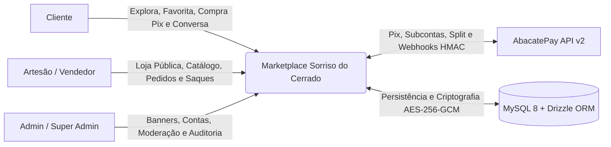

# Sorriso do Cerrado — Documentação Oficial

**Disciplina:** Soluções Computacionais — 2026/2  
**Instituição:** Universidade Católica de Brasília (UCB) — Curso de Engenharia de Software  
**Turma:** `GPE17M80081`

---

## Integrantes do Grupo

*Identificação completa em ordem alfabética:*

| Nome Completo | Matrícula | Turma | GitHub |
| :--- | :---: | :---: | :--- |
| **Gabriel Cézar Peres Matos** | `UC23102346` | `GPE17M80081` | [@gbrielzera](https://github.com/gbrielzera) |
| **Pedro Henrique Cavalcante de Sousa** | `UC24102627` | `GPE17M80081` | [@pedrocavati](https://github.com/pedrocavati) |
| **Samantha Yumi Tanaka** | `UC23201068` | `GPE17M80081` | [@ySamantha](https://github.com/ySamantha) |
| **Samuel Batista Rennó** | `UC23102986` | `GPE17M80081` | [@SamuelBati](https://github.com/SamuelBati) |
| **Vinicios Trindade Costa** | `UC23102647` | `GPE17M80081` | [@Vinhicious](https://github.com/Vinhicious) |

---

## Vídeo de Apresentação do Projeto

[Apresentação do projeto Sorriso do Cerrado disponível no YouTube](https://youtu.be/uac34t2DagU)

!!! tip "Demonstração Funcional"
    Assista ao vídeo acima para acompanhar a demonstração completa das telas e dos fluxos de navegação da plataforma **Sorriso do Cerrado** em funcionamento.

---

## Visão Geral do Projeto

O **Sorriso do Cerrado** é uma plataforma web de **marketplace colaborativo multi-artesãos** voltada ao artesanato regional do Cerrado brasileiro. Evoluindo da vitrine virtual monoprodutor desenvolvida no semestre anterior para um ecossistema completo de comércio eletrônico, o sistema oferece:

* **Lojas Públicas por Artesão:** cada artesão cadastrado possui página própria com capa, logo, história, catálogo isolado e informações de envio e produção.
* **Checkout via Pix com Split Automático (AbacatePay API v2):** pagamento único por QR Code Pix com divisão automática entre comissão da plataforma e subconta de cada artesão, confirmação assíncrona via webhook (HMAC-SHA256 + idempotência), consulta de saldo e solicitação de saques.
* **Central de Mensagens:** comunicação direta entre clientes e lojas/artesãos com controle de conversas únicas por par de participantes e contador de não lidas.
* **Painel do Artesão e Administração Hierárquica:** gestão autônoma de catálogo, estoque, pedidos, recebimentos e resumo de vendas para artesãos; governança de banners, indicadores, contas de usuários, administradores (`admin` e `super_admin`), exclusão lógica (*soft delete*) e trilha de auditoria (`admin_audit_logs`).
* **Segurança e Proteção de Dados:** autenticação baseada em sessões por cookie com **Better Auth** e criptografia simétrica autenticada **AES-256-GCM** para documentos fiscais, endereços e dados financeiros dos artesãos.

---

## Stack Tecnológica Atual (2026/2)

| Camada | Tecnologia | Papel na Arquitetura |
| :--- | :--- | :--- |
| **Front-End** | React 19 + Vite 6 + TypeScript | Single Page Application (SPA) responsiva com contextos de autenticação, carrinho, notificações e tema. |
| **Back-End** | Node.js 22 + Fastify 5 + TypeScript (`tsx`) | API RESTful modular com rotas protegidas, upload multipart e receptor de webhooks. |
| **Autenticação** | Better Auth | Autenticação por e-mail/senha com hash seguro, sessões persistidas em banco e cookies HTTP, com controle por papéis (`cliente`, `artisan`, `admin`, `super_admin`). |
| **Persistência** | MySQL 8 + Drizzle ORM / Drizzle Kit | Banco relacional com migrações versionadas (`0000` a `0011`) e transações ACID. |
| **Pagamentos** | AbacatePay API v2 | Cobranças Pix transparentes, subcontas por artesão, split automático de comissão, webhooks assinados (HMAC-SHA256) e saques. |
| **Segurança de Dados** | `node:crypto` (AES-256-GCM) | Cifragem em repouso de CPF/CNPJ, telefone, endereço, chave Pix e dados bancários dos artesãos. |
| **Infraestrutura** | Docker & Docker Compose | Orquestração dos contêineres `sorriso_frontend`, `sorriso_backend` e `sorriso_mysql`. |

---

## Documentos Principais da Entrega

* **[Business Model Canvas (`BMC.pdf`)](BMC.pdf)** — Modelo de negócio atualizado ([ver página resumida](engenharia/bmc.md)).
* **[Modelo de Dados (`DADOS.pdf`)](DADOS.pdf)** — Especificação lógica, física, relacional e DER ([ver página resumida](engenharia/modelo-de-dados.md)).
* **[Documento de Visão (v2.1)](engenharia/visao.md)** — Estratégia, stakeholders, prioridades e mecanismos arquiteturais ([baixar PDF](assets/v2/documentos/Documento_de_Visao_-_v2.1.pdf)).
* **[Requisitos e Casos de Uso (v3.0)](engenharia/requisitos.md)** — RF001–RF016, RNF001–RNF011 e UC001–UC012 ([baixar PDF](assets/v2/documentos/Documento_de_Requisitos_e_Casos_de_Uso_-_v3.0.pdf)).
* **[Documento de Arquitetura de Software (v2.0)](engenharia/arquitetura.md)** — Visão 4+1, UC001–UC019, matriz de qualidade e pendências técnicas ([baixar PDF](assets/v2/documentos/Documento_de_Arquitetura_de_Software_-_v2.0.pdf)).

---

## Navegação Rápida

| Seção | Conteúdo |
| :--- | :--- |
| [**Engenharia de Software**](engenharia/bmc.md) | Business Model Canvas, Documento de Visão v2.1, Requisitos v3.0, Histórias de Usuário, Casos de Uso, Arquitetura 4+1 v2.0, Modelo de Dados e Interfaces. |
| [**Diagramas do Sistema**](diagramas/casos-de-uso.md) | Casos de Uso v2.0, Fluxos de Navegação, 12 Diagramas de Atividades (com `.drawio`), 6 Diagramas de Classes, 4 Diagramas de Sequência, Arquitetura, Pacotes e Implantação UML. |
| [**Protótipos & Telas**](prototipos/mockups.md) | Novos protótipos do Marketplace (Explorar, Loja do Artesão, Painel do Vendedor e Configurações da Loja) integrados aos protótipos e telas implementadas contínuas. |
| [**Testes de Software**](testes/plano-e-estrategia.md) | Estratégia de testes atualizada (Better Auth, Docker Compose, Banners, Jest e Cypress), matriz de qualidade v2.0, evidências e códigos-fonte. |
| [**Central de Downloads**](downloads/index.md) | Todos os arquivos PDF, DOCX editáveis e diagramas `.drawio` organizados para consulta e download. |
| [**Material do Semestre Anterior**](semestre-anterior/index.md) | Acervo histórico completo dos documentos, diagramas, protótipos e testes produzidos no semestre anterior (Versão 1.0). |
