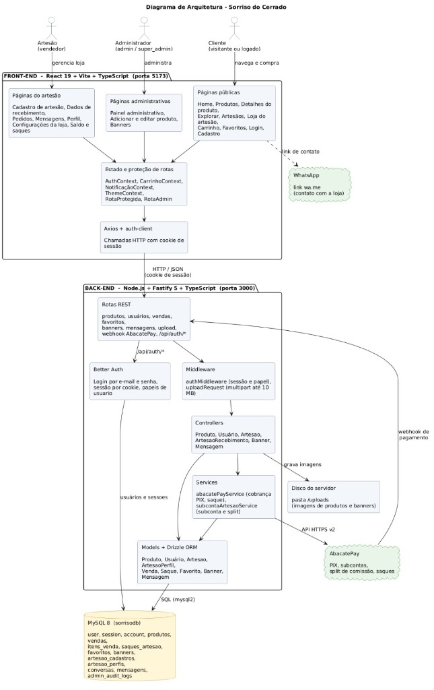
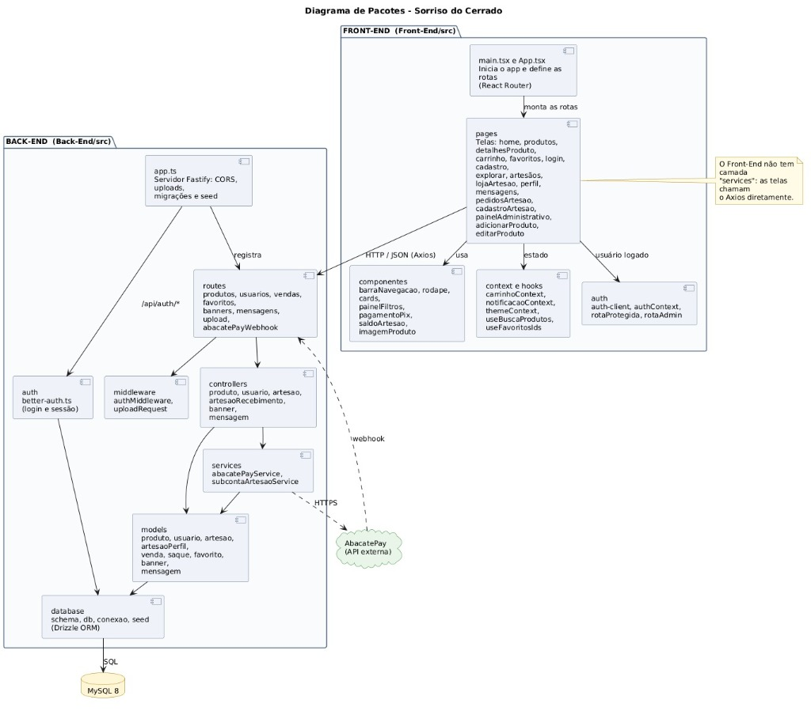

# Diagramas de Arquitetura, Pacotes e Implantação (v2.0)

Esta seção reúne as visões estruturais e físicas atualizadas da arquitetura do marketplace **Sorriso do Cerrado (v2.0)**, refletindo a migração para **React 19 + Vite 6**, **Node.js 22 + Fastify 5**, **Drizzle ORM + MySQL 8**, **Better Auth**, **AbacatePay API v2** e **Docker Compose**.

---

## 1. Diagrama de Arquitetura do Sistema

Apresenta a interação completa entre os atores (**Artesão**, **Administrador** e **Cliente**), as camadas do **Front-End** (páginas públicas/artesão/admin, contextos e Axios/auth-client), o **Back-End** (rotas REST, Better Auth, middlewares, controllers, services, models + Drizzle ORM e disco `/uploads`), o banco **MySQL 8 (`sorrisodb`)** e as integrações externas (**AbacatePay** com webhooks e link de contato **WhatsApp**).

---

## 2. Diagrama de Pacotes da Aplicação

Detalha a organização real dos diretórios e dependências entre `Front-End/src` (`main.tsx`/`App.tsx`, `pages`, `componentes`, `context`/`hooks`, `auth`) e `Back-End/src` (`app.ts`, `routes`, `auth`, `middleware`, `controllers`, `services`, `models`, `database`), destacando a comunicação HTTP/JSON e a integração HTTPS/webhook com a AbacatePay.

---

## 3. Diagrama de Implantação UML (Docker Compose)

Especifica os nós físicos e contêineres (`Estação do Usuário / Navegador Web`, `Host de Aplicação / Docker` executando `Node.js 22 (tsx / Fastify 5)` e `Servidor de Banco MySQL`, e nó externo `AbacatePay`), portas (`:5173`, `:3000`, `:3306` / `:3307`), diretório `/uploads/`, migrações `drizzle/0000..0011`, criptografia `AES-256-GCM` e protocolos de comunicação (HTTP/HTTPS, TCP/MySQL e Webhooks v2 com HMAC-SHA256).

<iframe src="../../assets/v2/diagramas/arquitetura/Diagrama_de_Implantacao_UML.pdf" width="100%" height="620" style="border: 1px solid rgba(141, 91, 76, 0.35); border-radius: 8px; background: #fff;">
  Seu navegador não suporta visualização embutida de PDF. <a href="../../assets/v2/diagramas/arquitetura/Diagrama_de_Implantacao_UML.pdf">Clique aqui para abrir ou baixar o Diagrama de Implantação UML (PDF)</a>.
</iframe>

[:material-file-pdf-box: Baixar Diagrama de Implantação UML (PDF)](../assets/v2/diagramas/arquitetura/Diagrama_de_Implantacao_UML.pdf){ .md-button .md-button--primary }
