# Diagramas de Atividades (12 Fluxos Atualizados)

Esta seção apresenta todos os **12 Diagramas de Atividades UML** atualizados para a **Versão 3.0** do sistema **Sorriso do Cerrado**, modelados em Draw.io com raias de responsabilidade (*swimlanes*) e acompanhados de seus respectivos arquivos editáveis `.drawio`.

---

## 1. Fazer Login (`1-FazerLogin`)

Ilustra o fluxo de autenticação por credenciais, tratamento de acesso negado, redefinição/recuperação de senha e redirecionamento para a página inicial.

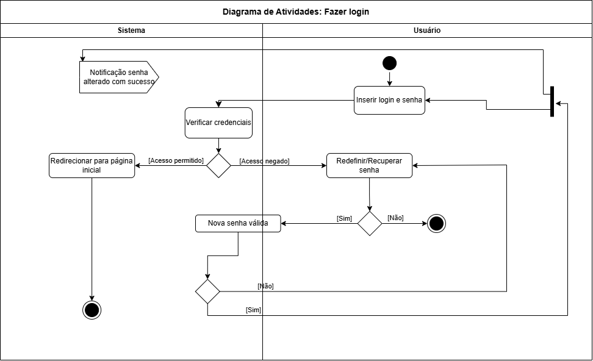

[:material-download: Baixar `1-FazerLogin.drawio`](../assets/v2/diagramas/atividades/1-FazerLogin.drawio){ .md-button }

---

## 2. Navegar no Catálogo (`2-NavegarCatalogo`)

Apresenta o carregamento da lista de produtos, opções de busca e filtragem e visualização dos detalhes de cada peça artesanal.

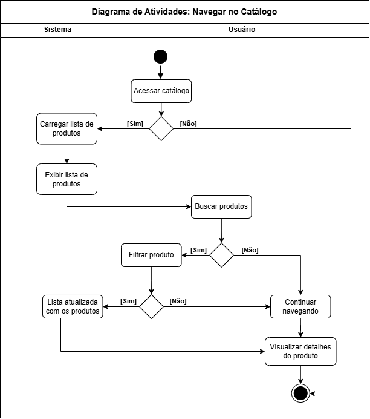

[:material-download: Baixar `2-NavegarCatalogo.drawio`](../assets/v2/diagramas/atividades/2-NavegarCatalogo.drawio){ .md-button }

---

## 3. Gerenciar Carrinho (`3-GerenciarCarrinho`)

Detalha a verificação de itens no carrinho, tratamento de carrinho vazio, alteração de quantidades, exclusão de itens, checagem de autenticação e prosseguimento para pagamento.

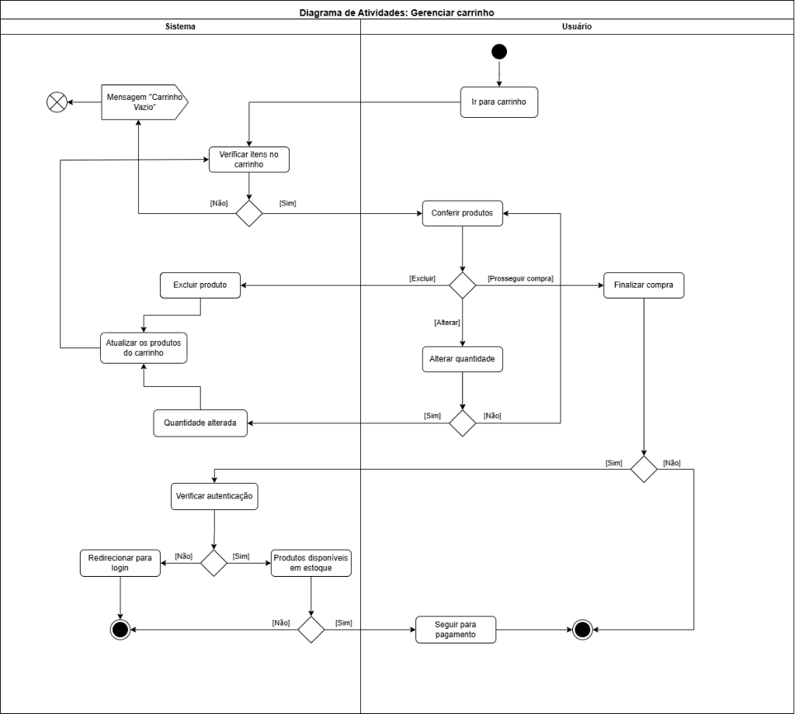

[:material-download: Baixar `3-GerenciarCarrinho.drawio`](../assets/v2/diagramas/atividades/3-GerenciarCarrinho.drawio){ .md-button }

---

## 4. Visualizar Painel de Controle (`4-PainelControle`)

Destaca a validação de credenciais e verificação do perfil de artesão para liberar o painel de controle (**Resumo/AbacatePay, Produtos, Pedidos, Configurações e Saques**), ou notificar acesso negado redirecionando à página inicial.

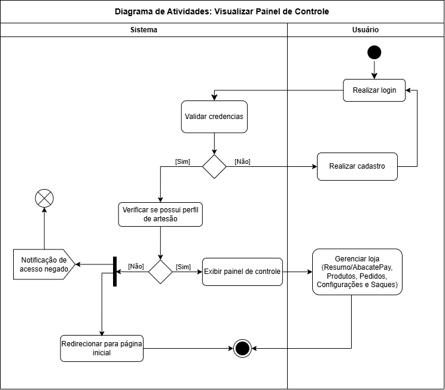

[:material-download: Baixar `4-PainelControle.drawio`](../assets/v2/diagramas/atividades/4-PainelControle.drawio){ .md-button }

---

## 5. Adicionar Produto (`5-AdicionarProduto`)

Fluxo em três raias (**Artesão**, **Sistema** e **Banco de Dados**) para inclusão de novos artesanatos no catálogo com validação de campos, tratamento de falhas e atualização da lista.

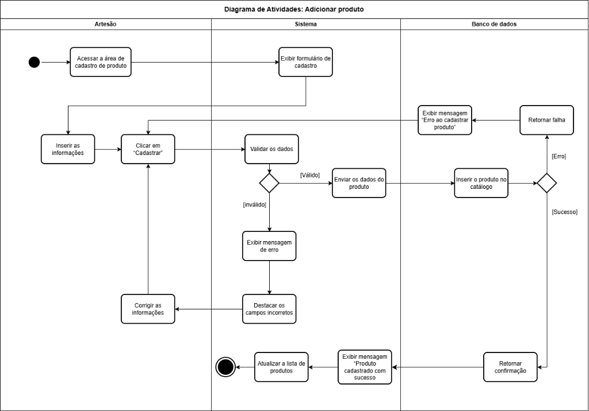

[:material-download: Baixar `5-AdicionarProduto.drawio`](../assets/v2/diagramas/atividades/5-AdicionarProduto.drawio){ .md-button }

---

## 6. Favoritar Produto (`6-FavoritarProduto`)

Modela a alternância (*toggle*) de produtos favoritos mediante verificação de sessão autenticada e consulta prévia ao banco.

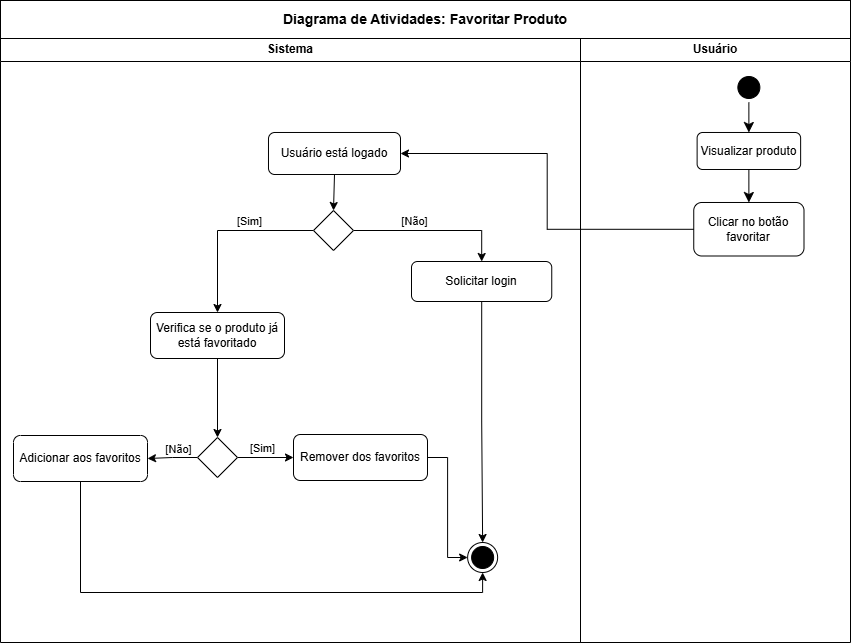

[:material-download: Baixar `6-FavoritarProduto.drawio`](../assets/v2/diagramas/atividades/6-FavoritarProduto.drawio){ .md-button }

---

## 7. Gerenciar Produtos do Catálogo (`7-ManterCatalogo`)

Detalha as operações de edição e exclusão de produtos no catálogo do artesão, com confirmação explícita de remoção e validação dos dados alterados.

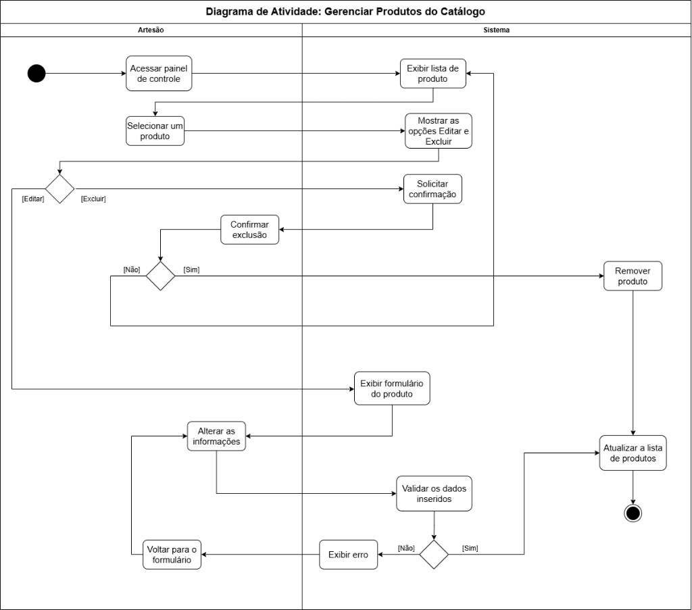

[:material-download: Baixar `7-ManterCatalogo.drawio`](../assets/v2/diagramas/atividades/7-ManterCatalogo.drawio){ .md-button }

---

## 8. Pesquisar Produto (`8-PesquisarProduto`)

Fluxo iterativo combinando busca por termo, aplicação de filtros dinâmicos, exibição de *"Nenhum produto encontrado"* e refinamento contínuo.

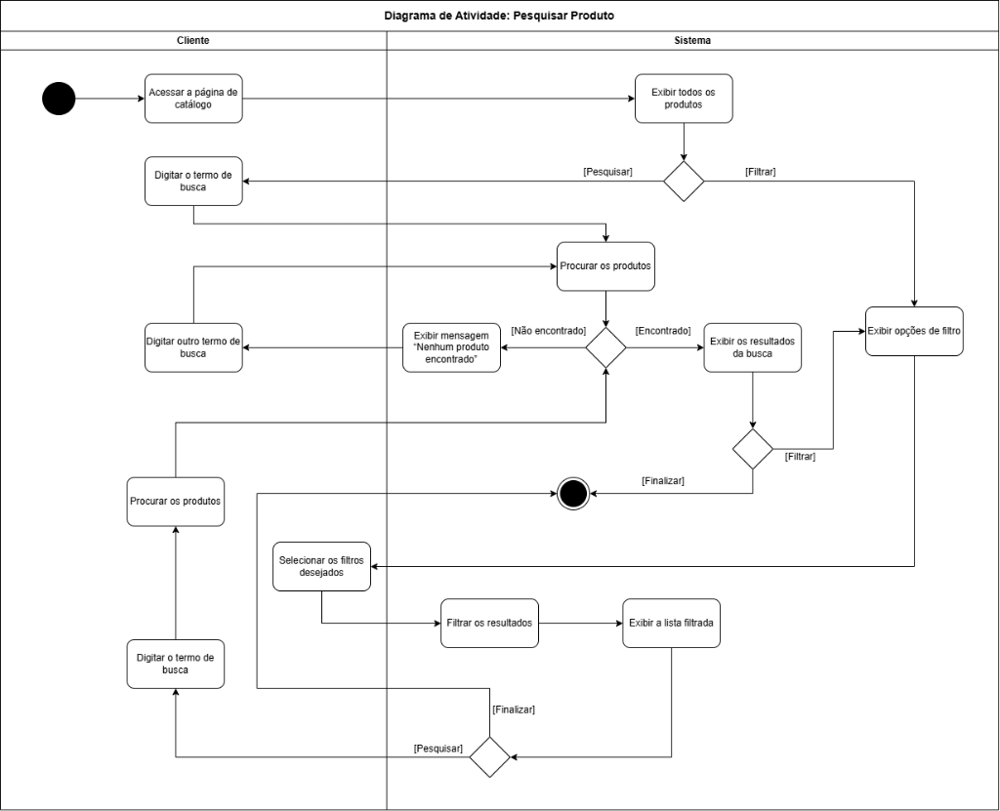

[:material-download: Baixar `8-PesquisarProduto.drawio`](../assets/v2/diagramas/atividades/8-PesquisarProduto.drawio){ .md-button }

---

## 9. Finalizar Compra (`9-FinalizarCompra`)

Fluxo em três raias (**Cliente**, **Sistema** e **Banco de Dados**) cobrindo cálculo do valor total, conferência de estoque, confirmação da compra, solicitação do pagamento e registro da venda.

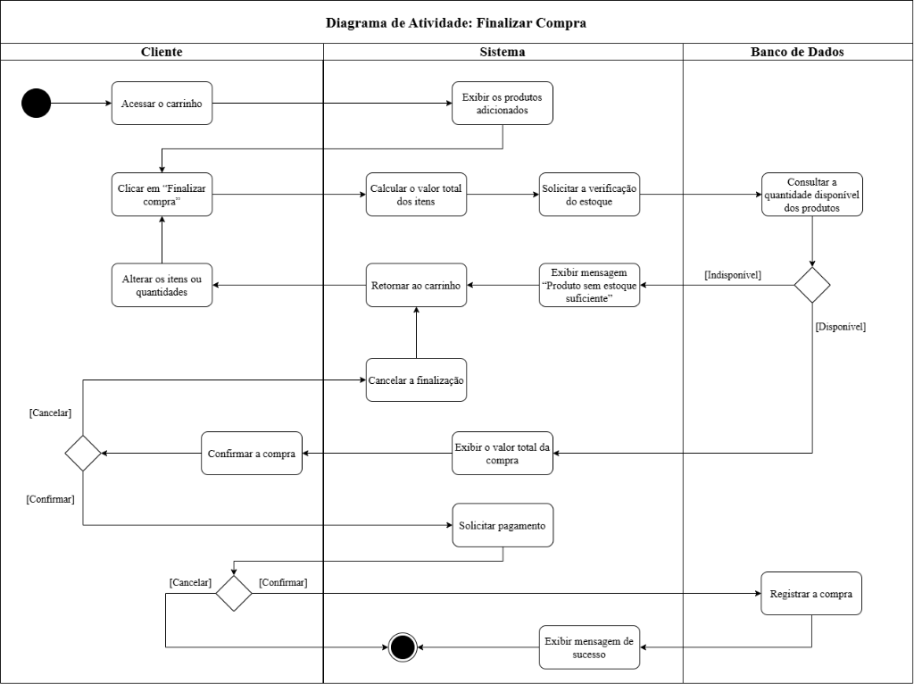

[:material-download: Baixar `9-FinalizarCompra.drawio`](../assets/v2/diagramas/atividades/9-FinalizarCompra.drawio){ .md-button }

---

## 10. Cadastro de Usuário / Cliente (`10-CadastroCliente`)

Modela o registro de novas contas com validação de dados, checagem de duplicidade no banco, alerta de conta existente e persistência.

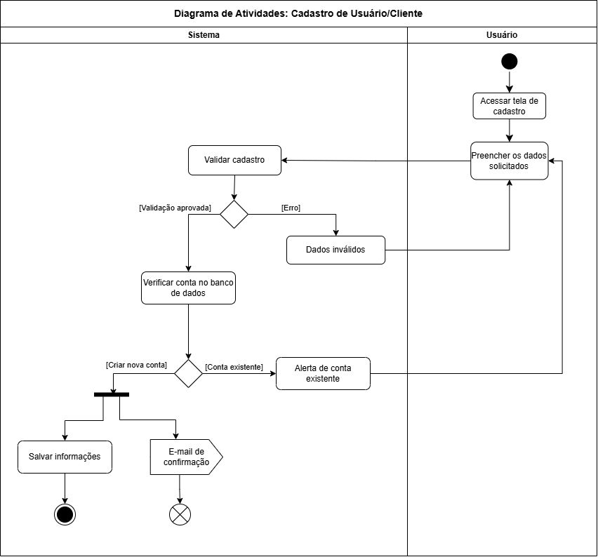

[:material-download: Baixar `10-CadastroCliente.drawio`](../assets/v2/diagramas/atividades/10-CadastroCliente.drawio){ .md-button }

---

## 11. Enviar Mensagem para a Loja (`11-EnviarMensagem`) — *Novo na v3.0*

Detalha a comunicação direta iniciada na loja pública: verificação de sessão ativa, consulta de conversa única por pares na base, carregamento ou abertura de nova conversa na **Central de Mensagens** e tratamento de erros de envio.

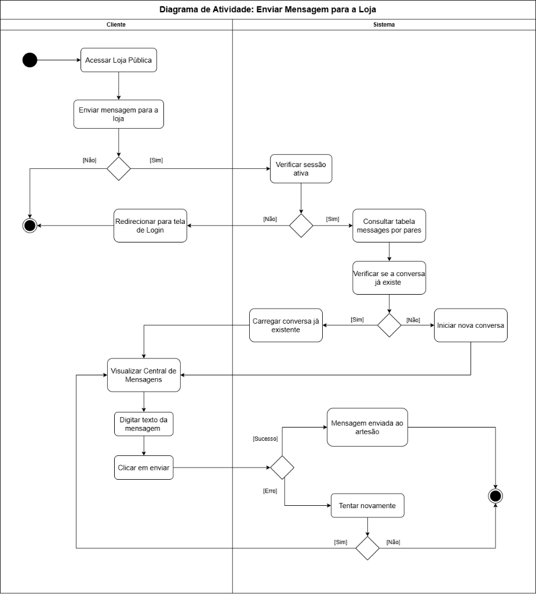

[:material-download: Baixar `11-EnviarMensagem.drawio`](../assets/v2/diagramas/atividades/11-EnviarMensagem.drawio){ .md-button }

---

## 12. Gerenciar Loja e Recebimentos do Artesão (`12-GerenciarLojaRecebimento`) — *Novo na v3.0*

Modela o acesso ao Painel do Artesão com carregamento da aba **Resumo** (métricas e gráficos) e os fluxos de edição em **Dados de Recebimento** e **Configurações da Loja**, com validação de campos e feedback ao usuário.

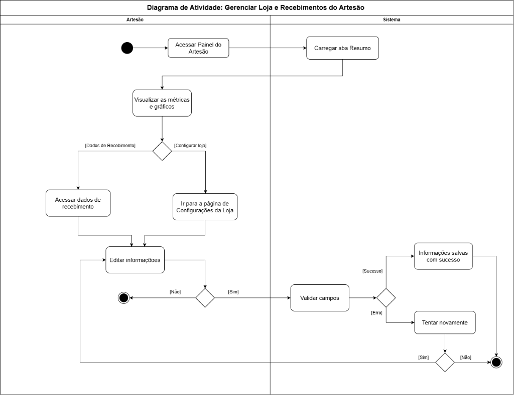

[:material-download: Baixar `12-GerenciarLojaRecebimento.drawio`](../assets/v2/diagramas/atividades/12-GerenciarLojaRecebimento.drawio){ .md-button }
