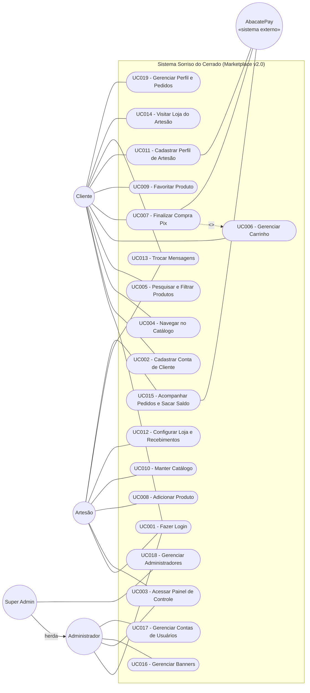

# Diagrama de Casos de Uso (v2.0)

O **Diagrama de Casos de Uso Geral (v2.0)** consolida todos os **19 casos de uso** do marketplace **Sorriso do Cerrado** e as interações entre seus cinco atores: **Cliente**, **Artesão**, **Administrador**, **Super Admin** (que herda as permissões do Administrador) e o sistema externo **AbacatePay**.

!!! info "Diagrama Completo no Documento de Arquitetura (v2.0)"
    A figura vetorial oficial (`Figura 2 — Diagrama de Casos de Uso Geral do Sistema Sorriso do Cerrado v2.0`) encontra-se na página 7 do [Documento de Arquitetura de Software v2.0 (PDF)](../assets/v2/documentos/Documento_de_Arquitetura_de_Software_-_v2.0.pdf).

---

## Mapa Interativo dos 19 Casos de Uso (v2.0)

---

## Quadro Resumo de Atores e Responsabilidades

| Ator | Casos de Uso Associados | Papel no Marketplace |
| :--- | :--- | :--- |
| **Cliente** | `UC001`, `UC002`, `UC004`, `UC005`, `UC006`, `UC007`, `UC009`, `UC011`, `UC013`, `UC014`, `UC019` | Explora catálogo e lojas públicas, pesquisa/filtra, favorita, gerencia carrinho, paga via Pix, troca mensagens, gerencia perfil e pode se tornar artesão. |
| **Artesão** | `UC001`, `UC003`, `UC008`, `UC010`, `UC012`, `UC013`, `UC015` | Gerencia catálogo próprio (CRUD isolado), loja pública, dados de recebimento, mensagens, pedidos recebidos, saldo e saques. |
| **Administrador** | `UC001`, `UC003`, `UC016`, `UC017` | Gerencia banners promocionais (até 10), acompanha indicadores e modera contas de clientes e artesãos. |
| **Super Admin** | Herda Administrador + `UC018` | Gerencia contas de administradores, realiza exclusão lógica (*soft delete*) e mantém auditoria em `admin_audit_logs`. |
| **AbacatePay** *(externo)* | `UC007`, `UC011`, `UC015` | Processa criação de subcontas, cobranças Pix com *split*, webhooks assinados (HMAC-SHA256) e transferências de saque. |

---

Para consultar as especificações textuais detalhadas de cada caso de uso, acesse [**Especificação de Casos de Uso**](../engenharia/casos-de-uso.md).
