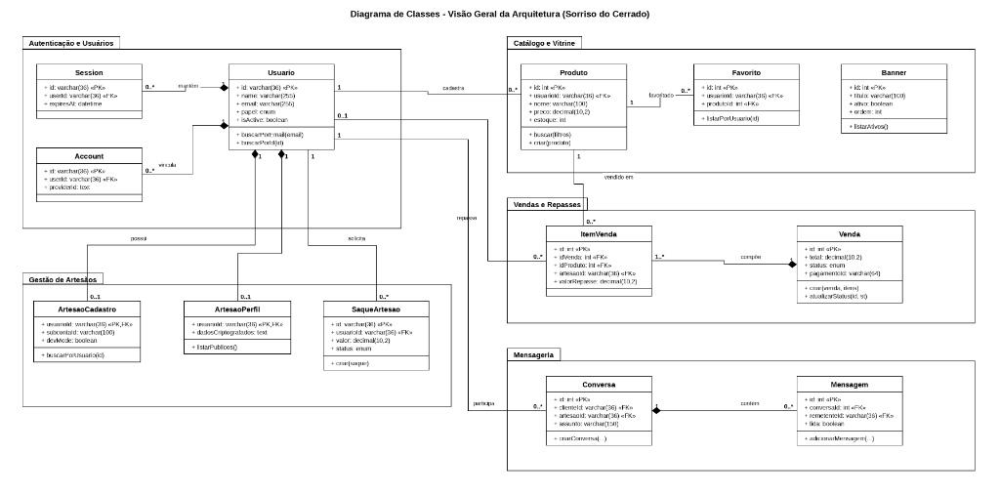
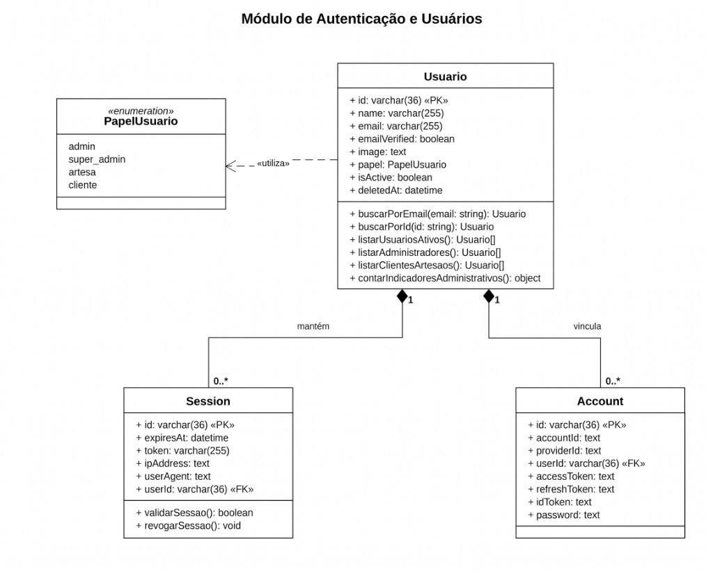
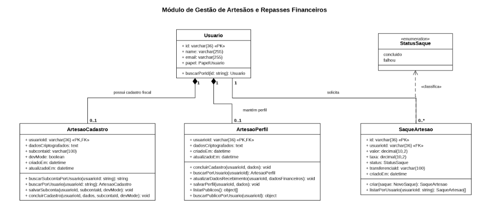
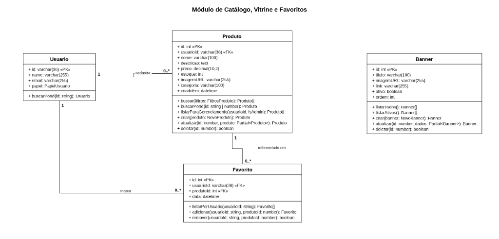
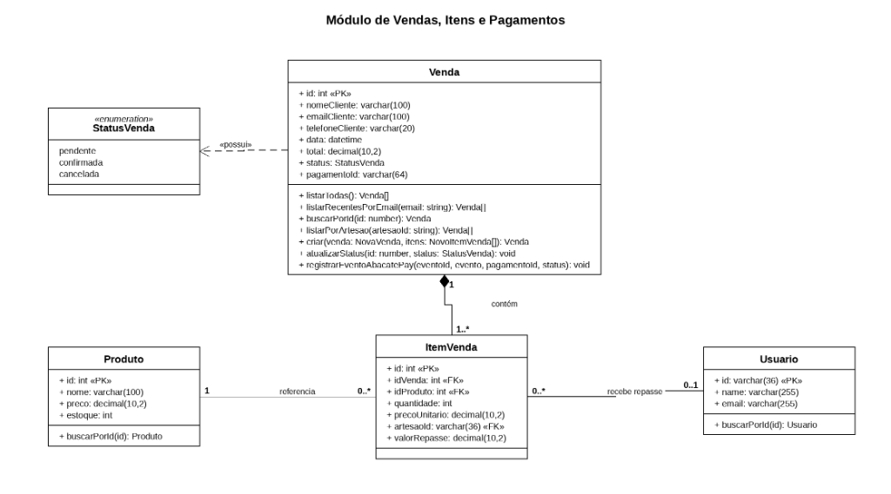
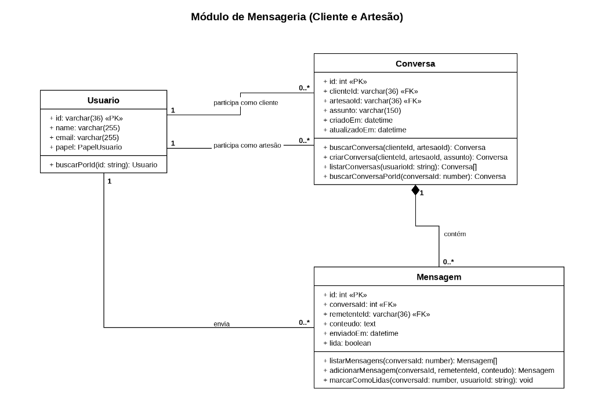

# Diagramas de Classes (6 Visões Modulares)

A modelagem estrutural do **Sorriso do Cerrado (v2.0)** está organizada em uma **visão geral da arquitetura** e **cinco módulos de domínio detalhados**, refletindo fielmente as entidades, atributos, enumerações, relacionamentos e operações implementados nos *models* com **Drizzle ORM** e **Better Auth**.

---

## 1. Visão Geral da Arquitetura (Diagrama de Classes Consolidado)

Integra todos os cinco módulos do sistema (**Autenticação e Usuários**, **Gestão de Artesãos**, **Catálogo e Vitrine**, **Vendas e Repasses** e **Mensageria**) e suas associações principais.

---

## 2. Módulo de Autenticação e Usuários

Modela `Usuario`, a enumeração `PapelUsuario` (`admin`, `super_admin`, `artesa`, `cliente`) e as composições com `Session` (validação e revogação de sessões Better Auth) e `Account` (provedores e credenciais).

---

## 3. Módulo de Gestão de Artesãos e Repasses Financeiros

Detalha a relação de `Usuario` com `ArtesaoCadastro` (cadastro fiscal e `subcontaId` AbacatePay), `ArtesaoPerfil` (dados da loja e recebimento cifrados) e `SaqueArtesao` (com a enumeração `StatusSaque`: `concluido`, `falhou`).

---

## 4. Módulo de Catálogo, Vitrine e Favoritos

Apresenta o vínculo de `Usuario` com `Produto` (cadastro, busca com filtros, gerenciamento e CRUD), `Favorito` (lista de desejos persistida) e a entidade independente `Banner` (gestão da vitrine principal).

---

## 5. Módulo de Vendas, Itens e Pagamentos

Modela `Venda` com a enumeração `StatusVenda` (`pendente`, `confirmada`, `cancelada`), registro de eventos AbacatePay e composição com `ItemVenda` (referenciando `Produto` e o `Usuario` artesão beneficiário do `valorRepasse`).

---

## 6. Módulo de Mensageria (Cliente e Artesão)

Detalha a estrutura de `Conversa` (associando `Usuario` como cliente e como artesão em conversa única por par) e sua composição com `Mensagem` (envio, listagem e marcação de leitura).

