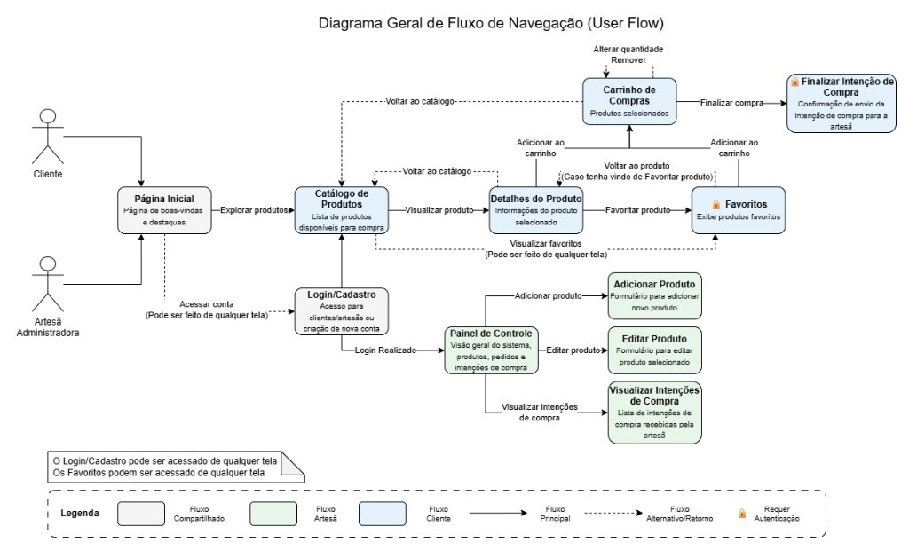
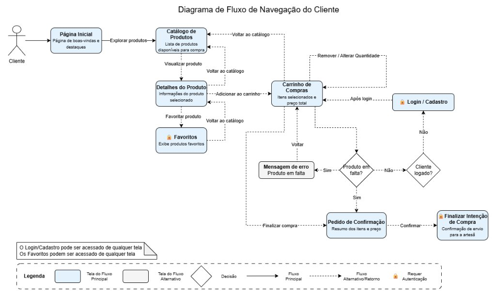

# Fluxos de Navegação (User Flows)

Os diagramas de fluxo de navegação detalham os caminhos percorridos pelos diferentes perfis de usuários entre as telas do **Sorriso do Cerrado**, diferenciando fluxos principais, fluxos alternativos/retorno e rotas que exigem autenticação.

---

## 1. Diagrama Geral de Fluxo de Navegação (User Flow)

Apresenta a visão unificada de navegação compartilhada, fluxo do cliente (catálogo, detalhes, favoritos, carrinho e finalização) e fluxo do painel de controle (gestão de produtos e acompanhamento de pedidos).

[:material-download: Baixar arquivo editável (`1-FluxoGeral.drawio`)](../assets/v2/diagramas/fluxos-de-navegacao/1-FluxoGeral.drawio){ .md-button }

---

## 2. Diagrama de Fluxo de Navegação do Cliente

Detalha a jornada completa do consumidor desde a página inicial até a confirmação da compra, contemplando autenticação sob demanda, validação de itens em falta, favoritos e gerenciamento do carrinho.

[:material-download: Baixar arquivo editável (`2-FluxoCliente.drawio`)](../assets/v2/diagramas/fluxos-de-navegacao/2-FluxoCliente.drawio){ .md-button }

---

## 3. Fluxos Complementares Contínuos

Os fluxos complementares de **Navegação da Artesã** e **Fluxo de Compra** (também preservados com seus arquivos `.drawio` editáveis) estão disponíveis no [Acervo de Fluxos de Navegação (Semestre Anterior)](../semestre-anterior/diagramas/fluxos-de-navegacao.md) e na [Central de Downloads](../downloads/index.md).
