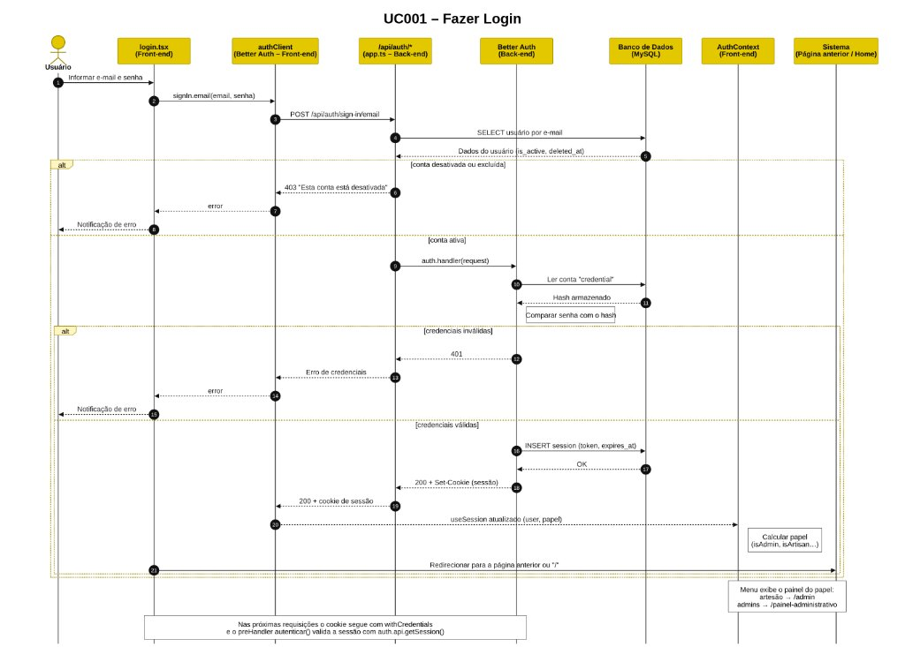
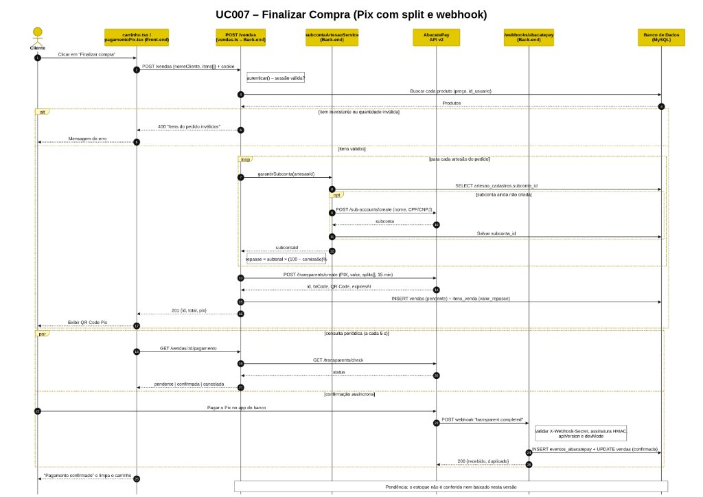
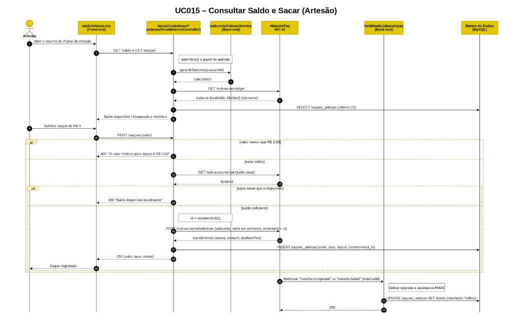
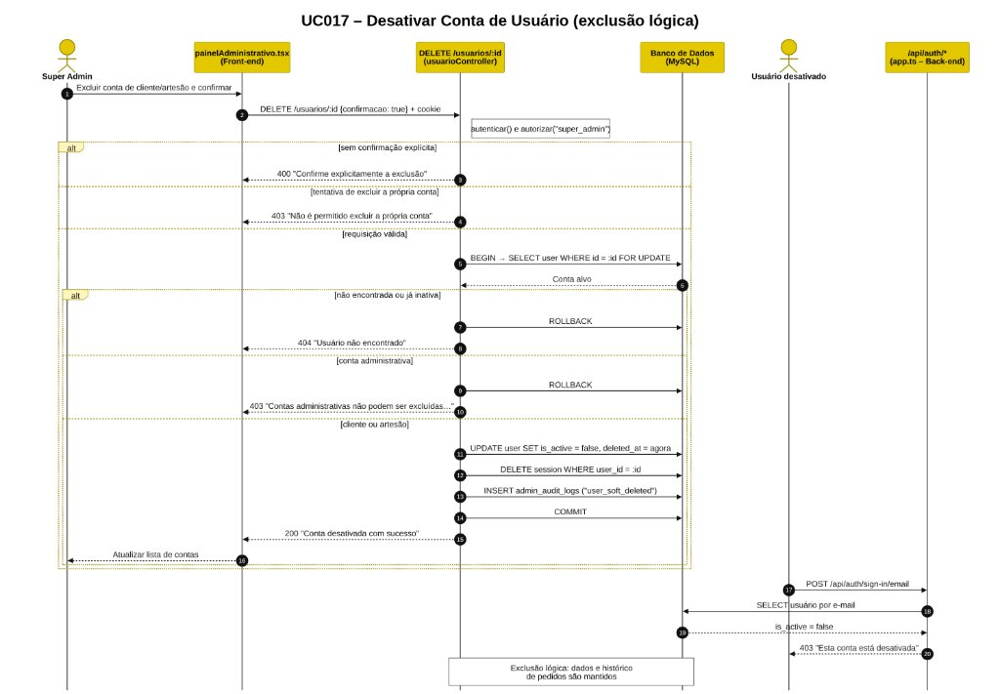

# Diagramas de Sequência (4 Fluxos Críticos — v2.0)

Os **Diagramas de Sequência UML** documentam o comportamento dinâmico e a troca de mensagens entre front-end (React), back-end (Fastify + Better Auth), banco de dados (MySQL) e o gateway externo **AbacatePay API v2** nos quatro fluxos arquiteturalmente mais significativos do marketplace.

---

## 1. UC001 — Fazer Login

Detalha o envio de credenciais via `authClient.signIn.email`, bloqueio preventivo de contas desativadas (`403`), conferência de hash pelo **Better Auth**, gravação de sessão na tabela `session`, retorno do cookie HTTP e atualização do `AuthContext` com cálculo do papel (`isAdmin`, `isArtisan`, etc.).

[:material-download: Baixar diagrama](../assets/v2/diagramas/sequencia/UC001-FazerLogin.jpg){ .md-button download="" }

---

## 2. UC007 — Finalizar Compra (Pix com Split e Webhook)

Documenta todo o ciclo de checkout transparente: recálculo de preços no banco, garantia da subconta de cada artesão (`subcontaArtesaoService.garantirSubconta`), cálculo de `valor_repasse` com desconto da comissão, criação da cobrança Pix com `splits[]` (`POST /transparents/create`), exibição do QR Code e os dois fluxos paralelos de confirmação — *polling* a cada 5s (`GET /vendas/:id/pagamento`) e webhook assíncrono `transparent.completed` com validação de `X-Webhook-Secret`, assinatura **HMAC-SHA256** e idempotência em `eventos_abacatepay`.

[:material-download: Baixar diagrama](../assets/v2/diagramas/sequencia/UC007-FinalizarCompraPix.jpg){ .md-button download="" }

---

## 3. UC015 — Consultar Saldo e Sacar (Artesão)

Mostra a consulta de saldo disponível/bloqueado e histórico de saques (`GET /usuarios/artesao/saldo` e `GET /saques`), validação do valor mínimo de **`R$ 3,50`** e do saldo disponível, solicitação de saque via `POST /sub-accounts/withdraw` com `externalId` UUID, registro em `saques_artesao` e atualização assíncrona via webhook (`transfer.completed` / `transfer.failed`) com validação HMAC.

[:material-download: Baixar diagrama](../assets/v2/diagramas/sequencia/UC015-ConsultarSaldoSacar.jpg){ .md-button download="" }

---

## 4. UC017 — Desativar Conta de Usuário (Exclusão Lógica)

Detalha o fluxo exclusivo do **Super Admin** para desativação de contas (`DELETE /usuarios/:id`): exigência de confirmação explícita, bloqueio de autoexclusão e proteção de contas administrativas, transação com `SELECT ... FOR UPDATE`, marcação lógica (`is_active = false`, `deleted_at`), encerramento de sessões (`DELETE FROM session`), registro em `admin_audit_logs` (`user_soft_deleted`) e bloqueio subsequente em tentativas de login (`403`).

[:material-download: Baixar diagrama](../assets/v2/diagramas/sequencia/UC017-DesativarContaUsuario.jpg){ .md-button download="" }
