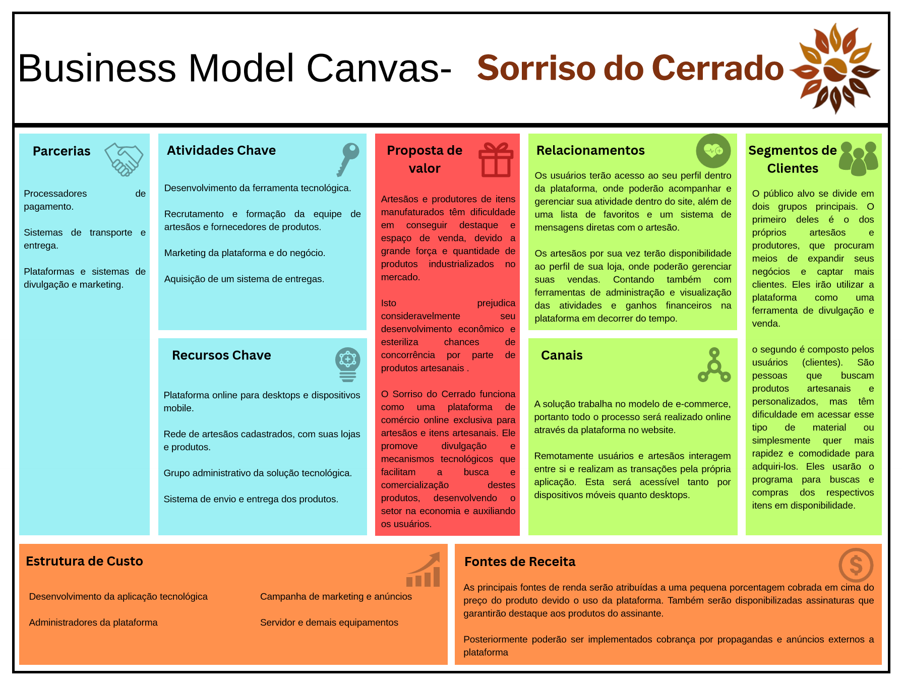

# Business Model Canvas — Sorriso do Cerrado

**Arquivo Oficial:** [`BMC.pdf`](../BMC.pdf)  
**Disciplina:** Soluções Computacionais — 2026/2  

O **Business Model Canvas (BMC)** consolida a proposta de valor, os segmentos de clientes, os canais de atendimento, a estrutura de custos e as fontes de receita do marketplace **Sorriso do Cerrado**.

---

## Visualização do Canvas

[:material-file-pdf-box: Baixar Business Model Canvas (PDF)](../BMC.pdf){ .md-button .md-button--primary }

---

## Detalhamento dos 9 Blocos do Modelo de Negócio

### 1. Proposta de Valor
Artesãos e produtores de itens manufaturados têm dificuldade em conseguir destaque e espaço de venda, devido à grande força e quantidade de produtos industrializados no mercado. Isso prejudica consideravelmente seu desenvolvimento econômico e reduz as chances de concorrência por parte de produtos artesanais.

O **Sorriso do Cerrado** funciona como uma plataforma de comércio online exclusiva para artesãos e itens artesanais, promovendo divulgação e mecanismos tecnológicos que facilitam a busca e a comercialização desses produtos, desenvolvendo o setor na economia e auxiliando os usuários.

### 2. Segmentos de Clientes
O público-alvo se divide em dois grupos principais:
* **Artesãos e Produtores:** buscam meios de expandir seus negócios e captar mais clientes, utilizando a plataforma como ferramenta de divulgação, gestão de loja e venda.
* **Usuários (Clientes):** pessoas que buscam produtos artesanais e personalizados, mas enfrentam dificuldade em acessar esse tipo de material ou desejam maior rapidez e comodidade para adquiri-los, utilizando a plataforma para buscas e compras.

### 3. Canais
* A solução trabalha no modelo de **e-commerce**, portanto todo o processo é realizado online através da plataforma no website.
* Remotamente, usuários e artesãos interagem entre si e realizam as transações pela própria aplicação, acessível tanto em **dispositivos móveis** quanto em **desktops**.

### 4. Relacionamentos com Clientes
* **Usuários (Clientes):** acesso ao perfil dentro da plataforma, permitindo acompanhar e gerenciar atividades, manter uma lista de favoritos e utilizar o sistema de mensagens diretas com o artesão.
* **Artesãos:** disponibilidade ao perfil da própria loja para gerenciar vendas, contando com ferramentas de administração e visualização de atividades e ganhos financeiros na plataforma ao longo do tempo.

### 5. Atividades-Chave
* Desenvolvimento e manutenção da ferramenta tecnológica.
* Recrutamento e formação da equipe de artesãos e fornecedores de produtos.
* Marketing da plataforma e do negócio.
* Aquisição e integração de um sistema de entregas.

### 6. Recursos-Chave
* Plataforma online para desktops e dispositivos móveis.
* Rede de artesãos cadastrados, com suas lojas e produtos.
* Grupo administrativo da solução tecnológica.
* Sistema de envio e entrega dos produtos.

### 7. Parcerias-Chave
* Processadores de pagamento (ex.: AbacatePay).
* Sistemas de transporte e entrega.
* Plataformas e sistemas de divulgação e marketing.

### 8. Estrutura de Custos
* Desenvolvimento da aplicação tecnológica.
* Administradores da plataforma.
* Campanhas de marketing e anúncios.
* Servidor e demais equipamentos de infraestrutura.

### 9. Fontes de Receita
* Pequena porcentagem (comissão) cobrada sobre o preço do produto pelo uso da plataforma (configurável no modelo de *split*).
* Disponibilização de planos de assinatura que garantam destaque aos produtos do assinante.
* Futuramente, cobrança por propagandas e anúncios externos à plataforma.
