# Protótipos de Alta Fidelidade

Esta seção reúne os **novos protótipos do Marketplace Multi-Artesãos (2026/2)** juntamente com os **protótipos contínuos** da plataforma que permanecem ativos na versão atual do **Sorriso do Cerrado**.

---

## Parte 1 — Novos Protótipos do Marketplace (2026/2)

### 1. Página Explorar / Marketplace Multi-Artesãos
Apresenta a nova vitrine principal com busca unificada (*"Buscar produto ou artesão"*), pílulas rápidas de categoria (*Bolsas, Colares, Cachecóis, Cerâmica, Cestaria, Decoração*), seção de **Artesãos em Destaque** (com cards de cada loja e botão *"Visitar loja"*) e grade de **Produtos Populares** com identificação da loja autora.

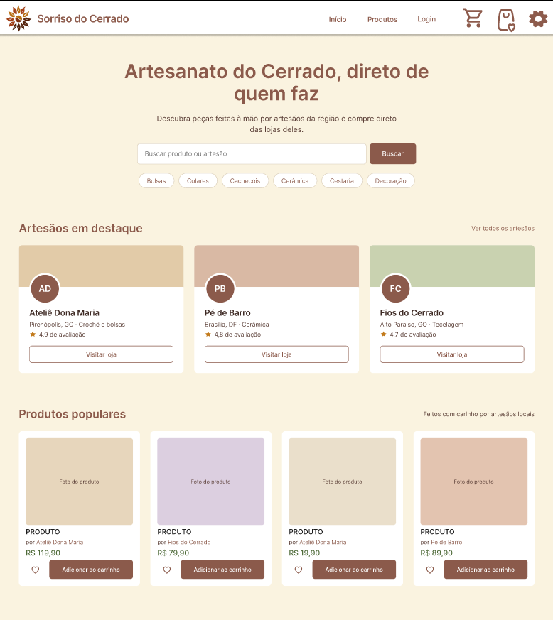

---

### 2. Página Pública da Loja do Artesão
Vitrine individual de cada vendedor (*ex.: Ateliê Dona Maria*), reunindo imagem de capa, logo circular, localização, avaliação, descrição autoral, botões de **Seguir loja** e **Enviar mensagem**, abas (*Produtos, Sobre, Avaliações*), ordenação e painel lateral com **Informações da loja** (envio, prazo de produção e pagamento) e atalho para a Central de Mensagens.

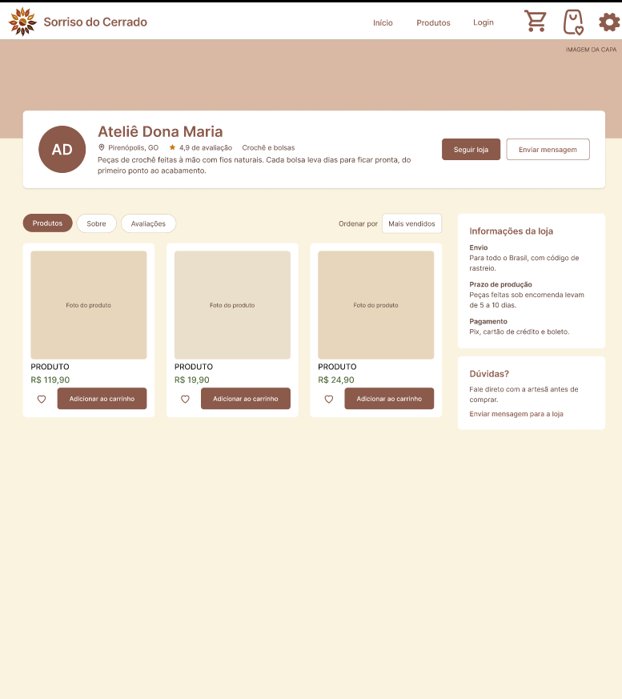

---

### 3. Painel do Vendedor — Aba Resumo
Área dedicada à gestão autônoma do artesão com menu lateral (*Resumo, Produtos, Pedidos, Mensagens, Configurações da loja*), atalho *"Adicionar Novo Produto"*, cards de métricas (**Vendas do mês**, **Pedidos novos**, **Produtos ativos**) e tabela de **Pedidos recentes** com badges de status (*Novo, Em preparo, Enviado*).

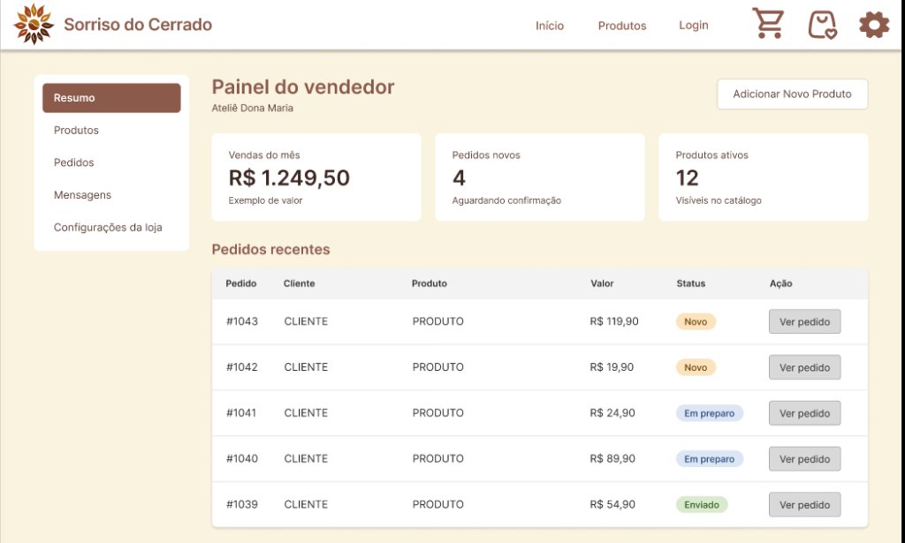

---

### 4. Configurações da Loja ("Minha Loja")
Interface intuitiva para o artesão personalizar sua loja pública: troca de logo, upload de imagem de capa, nome da loja, categoria principal, cidade/estado, WhatsApp de contato, descrição, prazo de produção, política de envio e formas de pagamento, com ações *Descartar* e *Salvar alterações*.

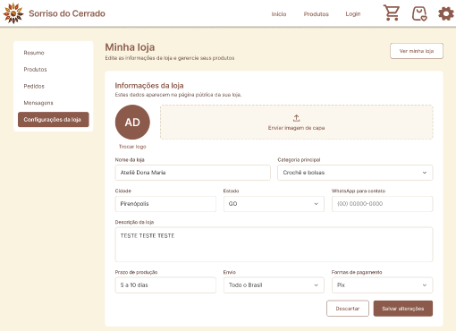

---

## Parte 2 — Protótipos Contínuos (Mantidos na Plataforma)

Os protótipos abaixo foram concebidos na fase inicial e continuam válidos e integrados aos fluxos centrais do sistema:

### 5. Página Inicial (Home)
Destaca o banner promocional principal com chamada para ação (*CTA*) e vitrine com produtos em destaque.

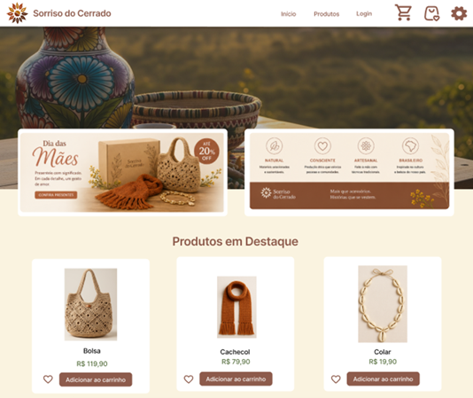

---

### 6. Catálogo de Produtos
Apresentação em grade responsiva com os artesanatos disponíveis, barra de pesquisa e filtros.

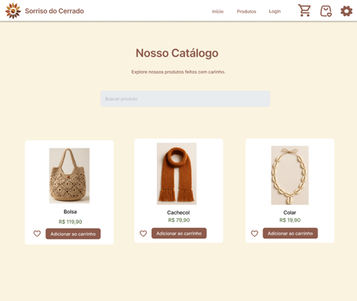

---

### 7. Detalhes do Produto
Página dedicada a uma peça específica com fotografia ampliada, descrição dos materiais, preço unitário e botão para adicionar ao carrinho.

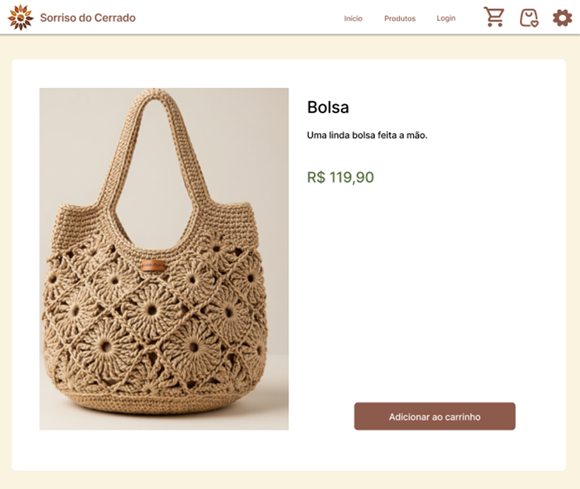

---

### 8. Tela de Autenticação (Login)
Formulário objetivo para entrada de e-mail e senha com acesso ao cadastro de nova conta.

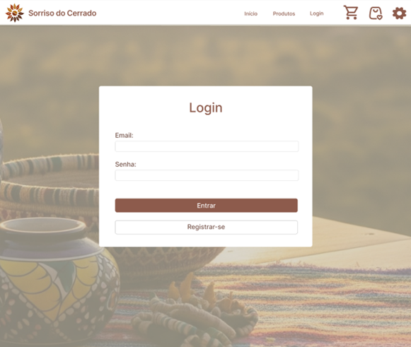

---

### 9. Meus Favoritos
Galeria personalizada contendo os produtos marcados como favoritos pelo usuário autenticado.

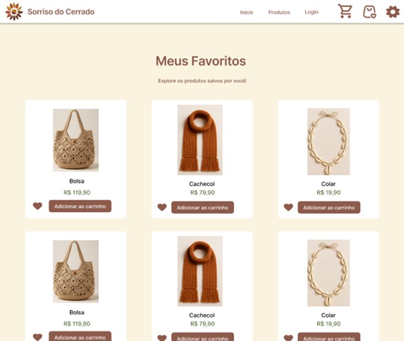

---

### 10. Carrinho de Compras
Tela de revisão dos itens selecionados com controle de quantidades, cálculo de totais e avanço para finalização.

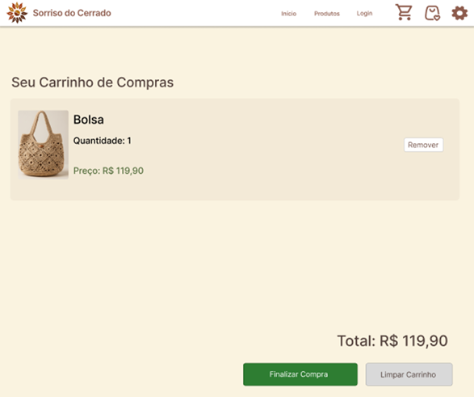

---

### 11. Painel de Produtos (Gerenciamento de Inventário)
Área restrita com tabela completa de inventário, preços e ações de edição e exclusão.

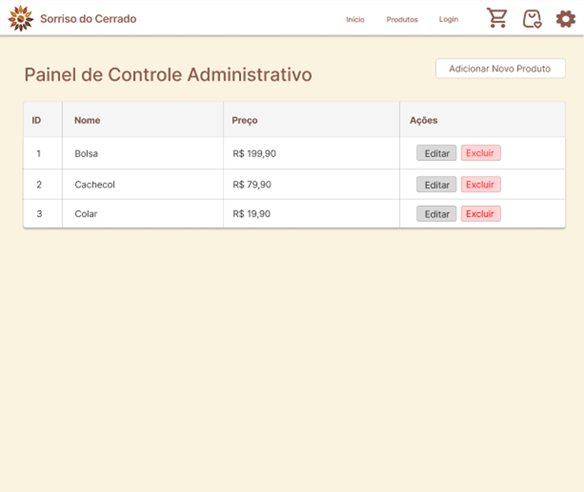

---

### 12. Adicionar Novo Produto
Formulário intuitivo para inclusão de novos artesanatos no catálogo com upload de foto e quantidade em estoque.

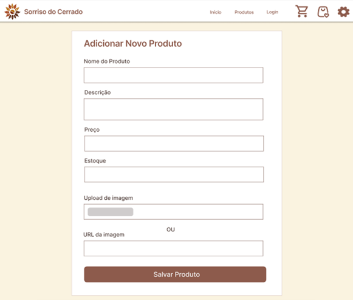
