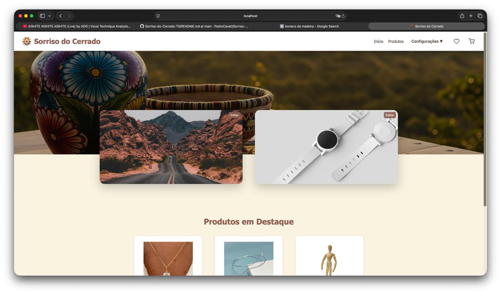
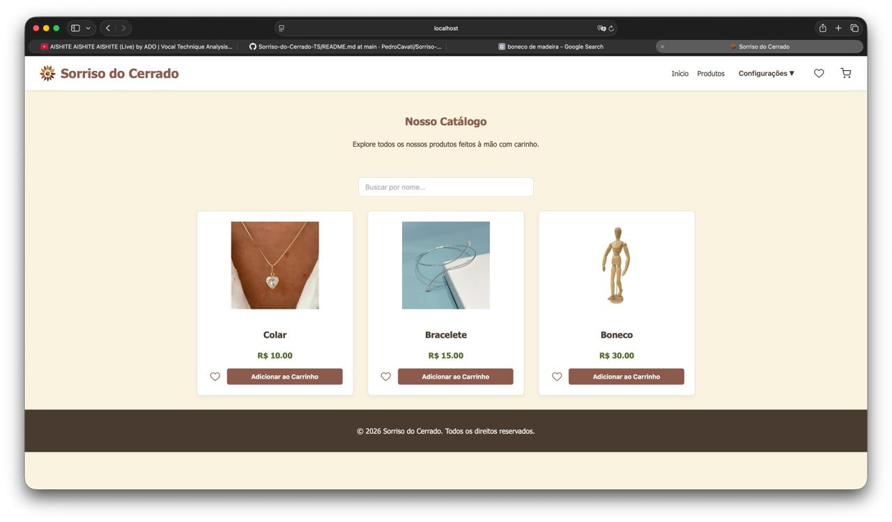
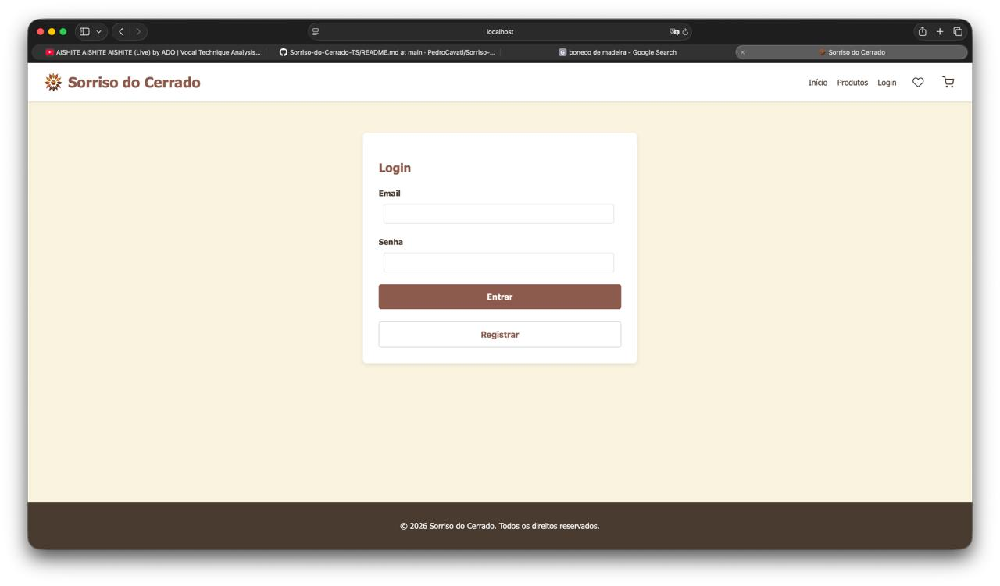
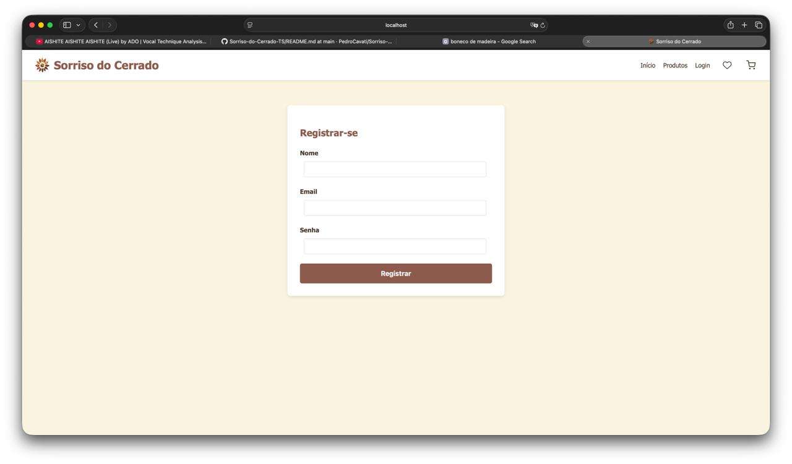
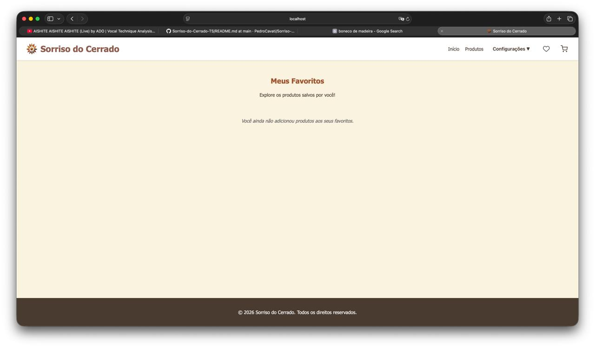
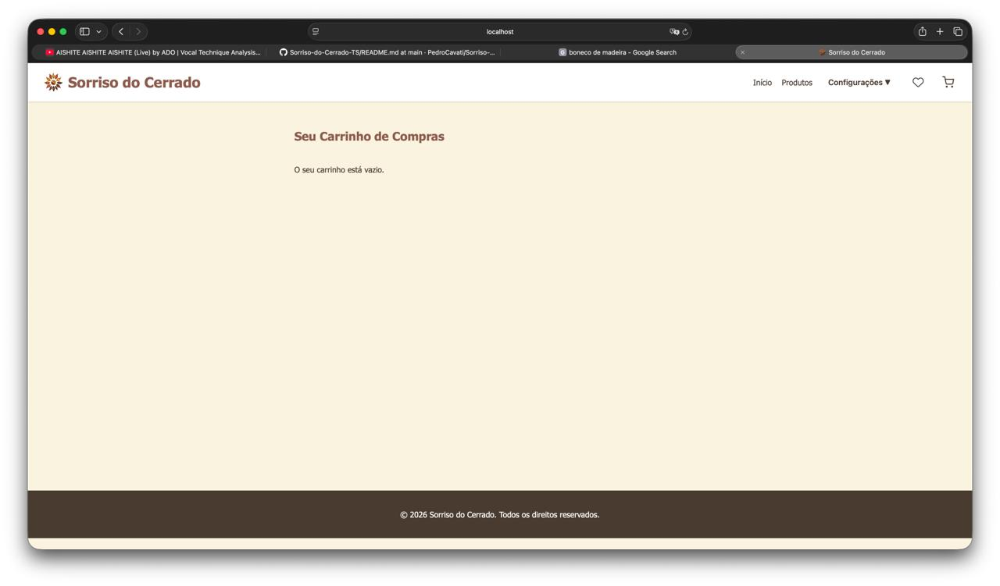
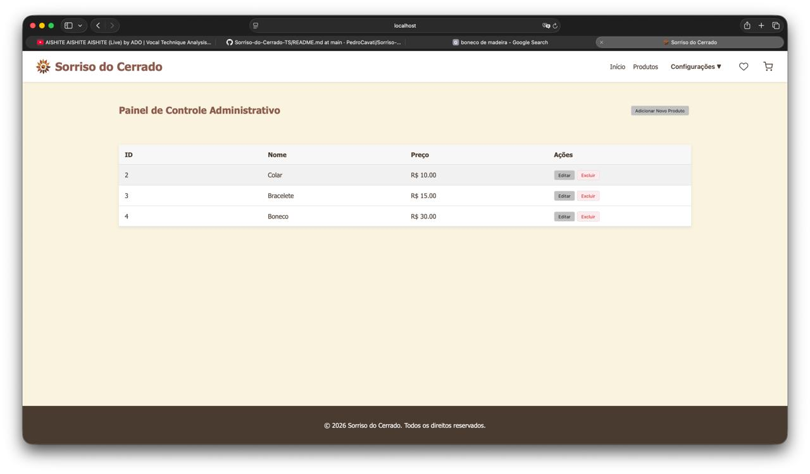
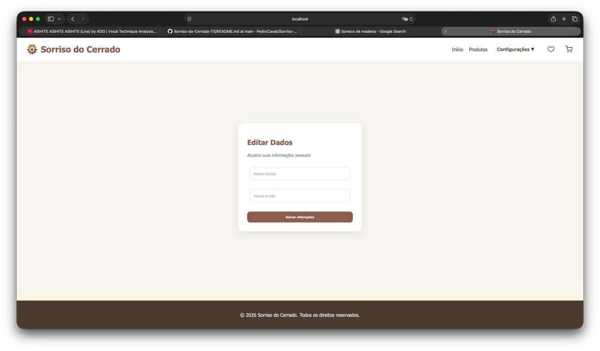
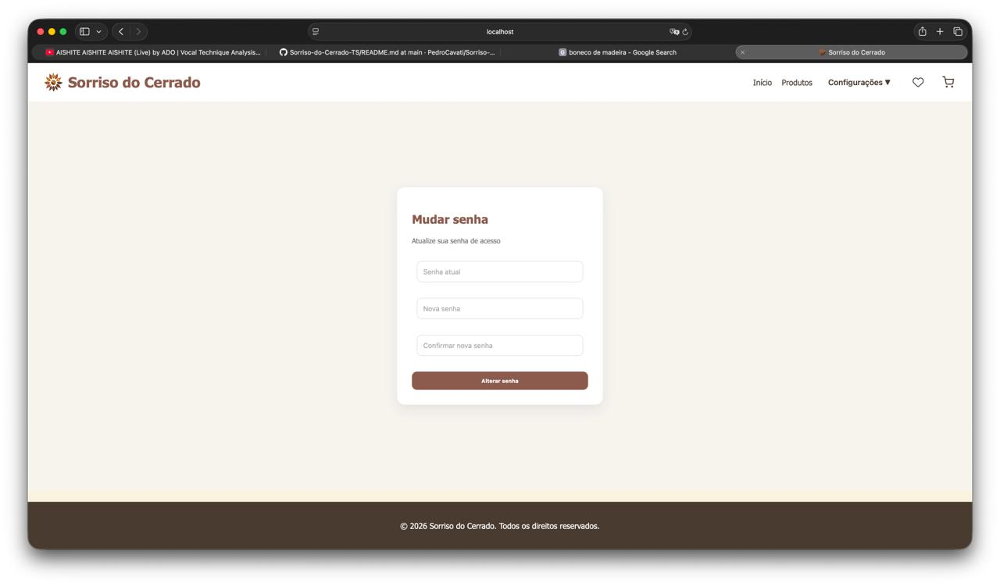

# Telas Implementadas da Aplicação

Esta seção documenta as telas em funcionamento do **Sorriso do Cerrado**, combinando a **demonstração em vídeo completa da Versão 2.0 (Marketplace)** com o catálogo de **telas implementadas contínuas** e o mapeamento das novas rotas entregues em **2026/2**.

!!! tip "Demonstração Completa das Telas em Funcionamento (YouTube)"
    Todas as telas da versão atual do marketplace — incluindo **Explorar**, **Lojas Públicas**, **Checkout Pix (AbacatePay)**, **Central de Mensagens**, **Cadastro de Artesão**, **Painel do Artesão (Resumo/Saldo/Saques/Configurações)** e **Painel Administrativo** — estão demonstradas em operação no vídeo oficial:

    [:material-youtube: Assistir à Demonstração no YouTube](https://youtu.be/uac34t2DagU){ .md-button .md-button--primary }

---

## 1. Novas Telas e Rotas do Marketplace (2026/2)

Além das telas contínuas exibidas abaixo, a versão atual implementada no repositório (`Front-End/src/pages`) incorpora os seguintes módulos de interface:

| Tela / Rota | Perfil de Acesso | Principais Recursos Implementados |
| :--- | :--- | :--- |
| **Explorar (`/explorar`)** | Público | Busca unificada, filtros laterais (`PainelFiltros`), ordenação e descoberta de peças e artesãos. |
| **Lista de Artesãos (`/artesaos`) e Loja Pública (`/artesaos/:id`)** | Público | Diretório de artesãos ativos e vitrine individual com capa, história, catálogo próprio e botão de mensagem. |
| **Checkout Pix (`PagamentoPix`)** | Cliente autenticado | Exibição de QR Code e código Pix copia-e-cola (AbacatePay), contagem regressiva e confirmação automática via *polling*/webhook. |
| **Central de Mensagens (`/mensagens`)** | Cliente / Artesão | Lista de conversas por par cliente–artesão, envio de mensagens, histórico e contador de não lidas. |
| **Perfil Unificado (`/perfil`)** | Usuário autenticado | Visão geral da conta, histórico de pedidos recentes, edição de dados pessoais, foto e troca de senha. |
| **Cadastro de Artesão (`/cadastro-artesao`)** | Cliente | Fluxo *"Quero vender"* com dados pessoais, endereço, loja e dados financeiros cifrados (AES-256-GCM). |
| **Painel do Artesão (`/admin`)** | Artesão / Admin | Abas de **Resumo** (gráficos, indicadores e `SaldoArtesao` com solicitação de saques), **Produtos**, **Pedidos**, **Configurações da Loja** e **Dados de Recebimento**. |
| **Painel Administrativo (`/painel-administrativo`)** | Admin / Super Admin | Indicadores globais, gestão de banners (até 10), moderação de contas, gestão de administradores (`super_admin`) e exclusão lógica com auditoria. |

---

## 2. Telas Implementadas Contínuas (Capturas da Aplicação)

As interfaces abaixo permanecem ativas na aplicação, evoluídas para integrar o fluxo completo do marketplace:

### 2.1 Página Inicial (Home)
Vitrine operacional com carrossel dinâmico de banners promocionais, produtos em destaque e rodapé institucional.

---

### 2.2 Catálogo de Produtos
Catálogo em funcionamento com carregamento dinâmico a partir da API REST e banco de dados MySQL.

---

### 2.3 Tela de Login
Interface de autenticação com validação de campos, Better Auth e feedback visual imediato.

---

### 2.4 Tela de Cadastro de Usuário
Formulário de criação de nova conta com validação de força de senha e unicidade de e-mail.

---

### 2.5 Tela de Meus Favoritos
Visualização da lista de produtos favoritos persistida individualmente por usuário no banco de dados.

---

### 2.6 Carrinho de Compras
Fluxo de cálculo dinâmico de subtotais, controle de quantidades e avanço para o checkout Pix integrado.

---

### 2.7 Painel de Controle de Produtos
Painel de gestão do catálogo com visualização tabular de itens, estoques e atalhos de manutenção CRUD.

---

### 2.8 Edição de Dados Pessoais
Interface do perfil do usuário permitindo a atualização de nome, e-mail e informações cadastrais.

---

### 2.9 Alteração de Senha
Formulário seguro para atualização de credenciais de acesso com checagem de senha atual e confirmação.

