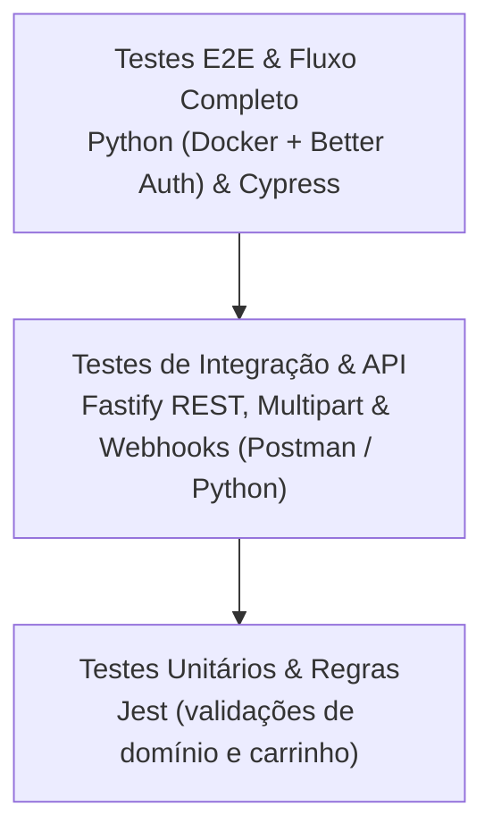

# Plano e Estratégia de Testes de Software (v2.0)

**Versão:** 2.0 (Marketplace Multi-Artesãos — 2026/2)  
**Objetivo:** Garantir a integridade funcional, a segurança de autenticação/papéis, a confiabilidade financeira (Pix + split + webhooks) e a estabilidade do marketplace **Sorriso do Cerrado**.

---

## 1. Escopo dos Testes

### 1.1 Dentro do Escopo (Validado na Versão 2.0)
* **Autenticação e Sessão (Better Auth):** cadastro, login por e-mail/senha, cookie HTTP, alteração de nome/e-mail com verificação de unicidade, troca de senha com revogação de sessões, logout e re-autenticação (`testes/e2e_flow_test.py`).
* **Controle de Acesso Baseado em Papéis (RBAC):** validação dos perfis `cliente`, `artisan`, `admin` e `super_admin`, bloqueio de rotas restritas com HTTP `401`/`403` e bloqueio de contas desativadas (*soft delete*).
* **Gestão de Banners e Upload Multipart:** criação de banners com URL externa e via upload de arquivo PNG (`multipart/form-data`), verificação na listagem pública e limpeza (`testes/banner_creation_test.py`).
* **Fluxos Comerciais e Multi-Artesãos:** catálogo, filtros, lojas públicas, favoritos persistidos, carrinho de compras, checkout Pix com *split* em ambiente de testes (`abc_dev_`) da AbacatePay, consulta de saldo/saques e central de mensagens.
* **Regras de Negócio e Interface (Suíte Contínua):** testes unitários em **Jest** e testes ponta a ponta em **Cypress** oriundos da base v1.0.

### 1.2 Fora do Escopo nesta Fase
* Testes de carga massiva em produção (a execução atual opera em ambiente local containerizado).
* Liquidação bancária real em ambiente produtivo da AbacatePay (utiliza-se a chave de teste `abc_dev_` com simulação de pagamento).

---

## 2. Pirâmide de Testes e Ferramentas

| Nível de Teste | Ferramentas | Foco Principal |
| :--- | :--- | :--- |
| **Unitário** | **Jest** | Validação isolada de regras puras (formato de e-mail, preços positivos, lógica do carrinho e papéis). |
| **Integração / API (v2.0)** | **Python (`urllib` + `CookieJar` + Docker Compose)** e **Postman** | Contratos HTTP do Fastify 5, cookies de sessão Better Auth, upload multipart, controle de papéis (`401`/`403`/`404`) e persistência no MySQL 8. |
| **End-to-End (E2E)** | **Cypress** e **Validação Funcional Completa** | Navegação real do usuário no navegador, catálogo, favoritos, carrinho, lojas públicas, mensagens e painéis. |

---

## 3. Ambiente e Responsabilidades (2026/2)

* **Ambiente:** Contêineres Docker Compose (`sorriso_frontend` na porta `5173`, `sorriso_backend` na porta `3000`, `sorriso_mysql` na porta `3306`/`3307`), Node.js 22, Python 3 e navegadores Chrome/Edge.
* **Equipe de Qualidade e Desenvolvimento (2026/2):** Gabriel Cézar Peres Matos, Pedro Henrique Cavalcante de Sousa, Samantha Yumi Tanaka, Samuel Batista Rennó e Vinicios Trindade Costa.

---

*Para consultar o plano original da Versão 1.0 (Express + JWT), acesse [Plano de Testes (Semestre Anterior)](../semestre-anterior/testes/plano-e-estrategia.md).*
